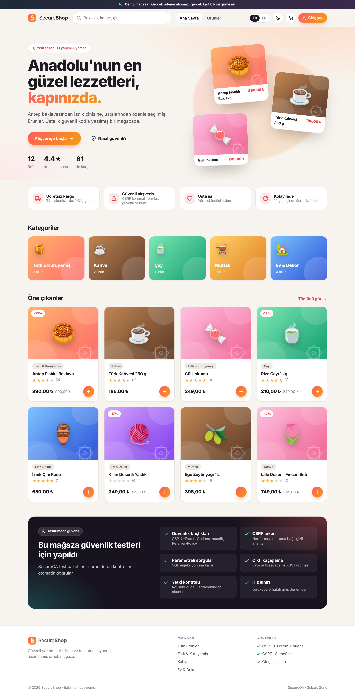
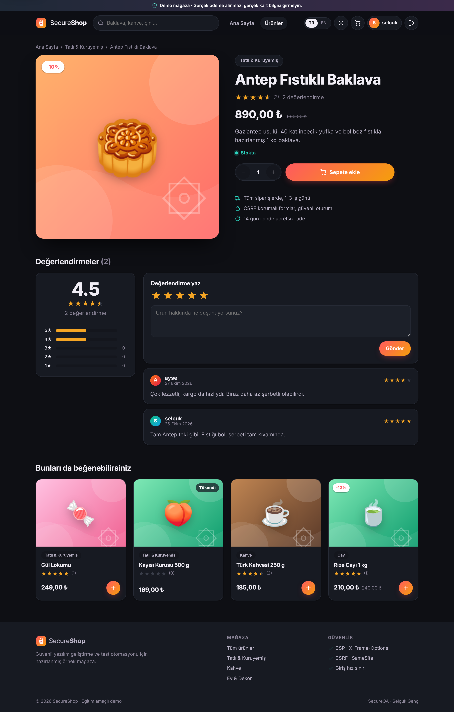
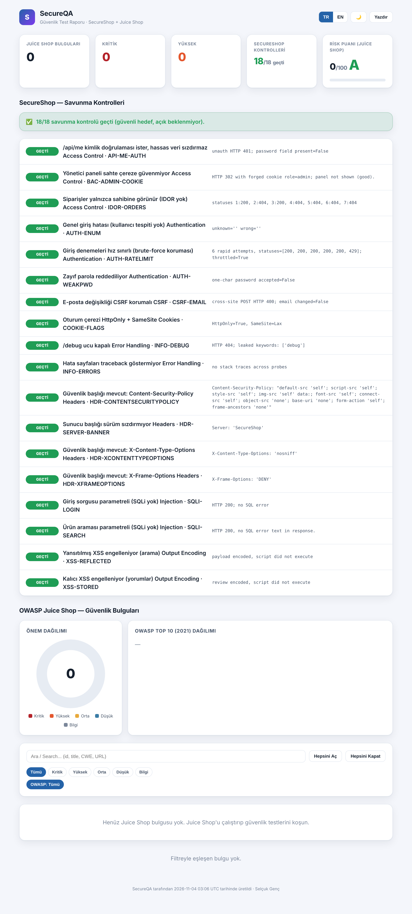
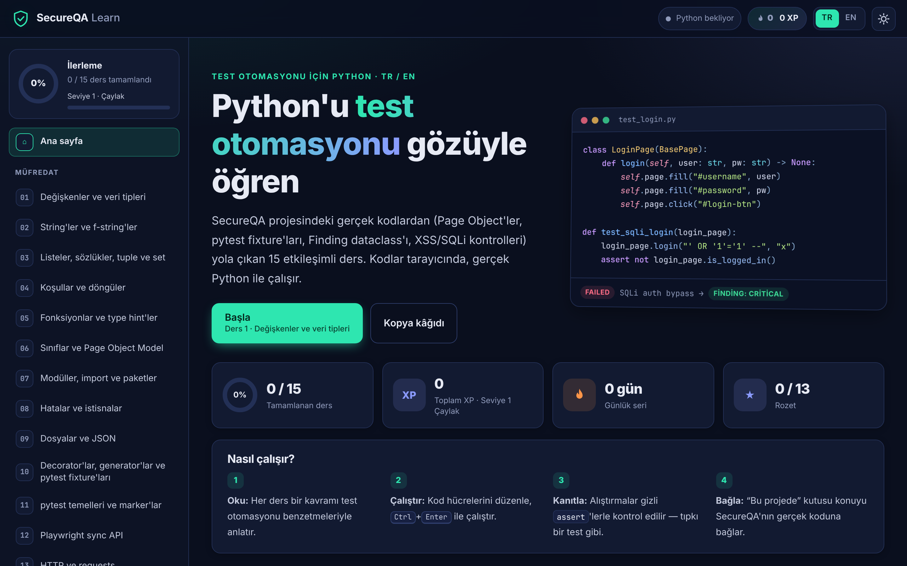
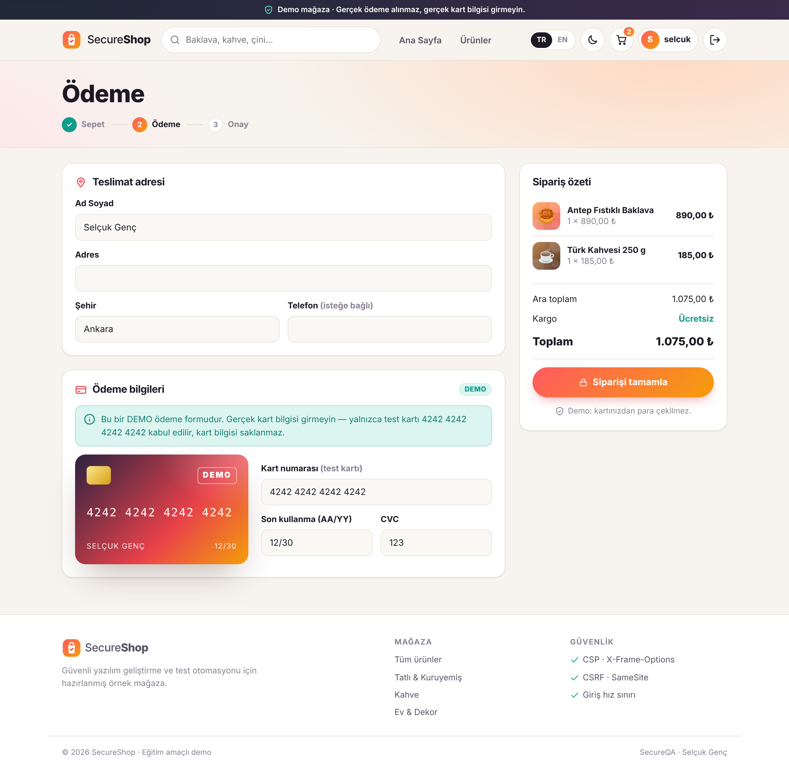
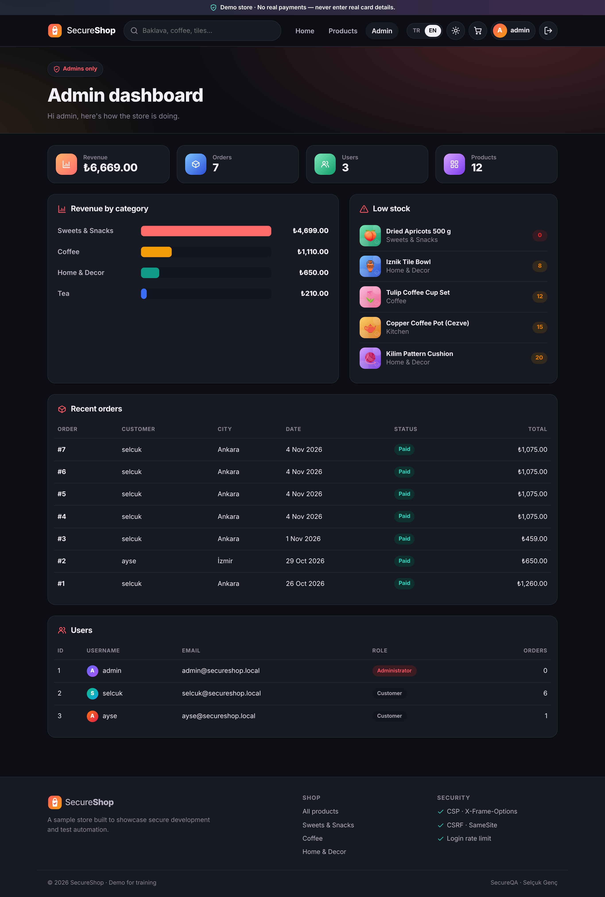
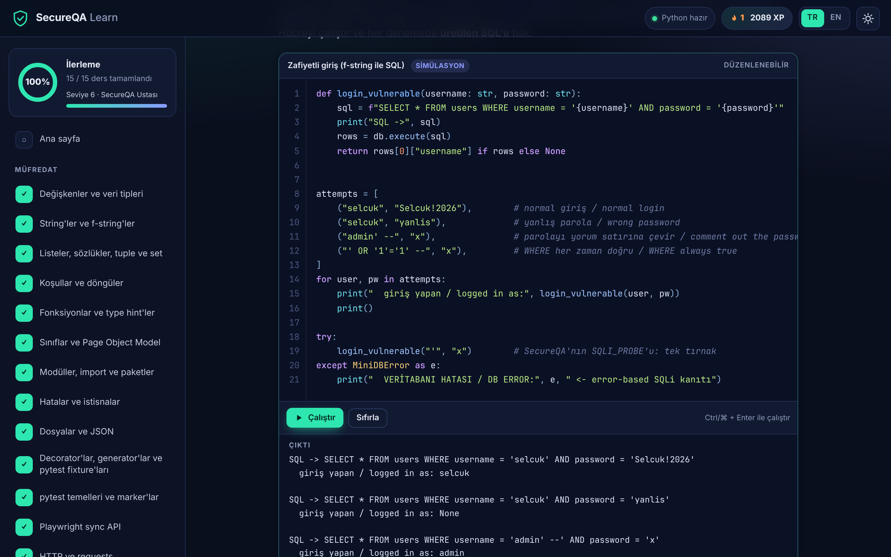

# 🛡️ SecureQA

**Python + Playwright + pytest ile güvenlik odaklı test otomasyonu** · *Security-focused test automation with Python, Playwright and pytest*

[🇹🇷 Türkçe](#-türkçe) · [🇬🇧 English](#-english)



---

## 🇹🇷 Türkçe

SecureQA, bir QA otomasyon mühendisinin güvenlik bilgisini otomasyona taşıdığı bir portföy projesidir. Üç parçadan oluşur:

| Parça | Ne yapar |
|---|---|
| 🛒 **SecureShop** (`demo_app/`) | Güvenli yazılmış, TR/EN, karanlık/aydınlık temalı Flask demo mağazası. Fonksiyonel testlerin ve savunma kontrollerinin hedefidir. |
| 🧪 **SecureQA framework** (`secureqa/`, `tests/`) | Page Object Model, yeniden kullanılabilir güvenlik kontrolleri, OWASP Top 10 (2021) ve CWE eşleştirmeli bulgular, tek dosyalık iki dilli HTML rapor paneli. |
| 🧃 **OWASP Juice Shop** hedefi (`tests/juiceshop/`) | Bilerek açıklı, açık kaynak eğitim uygulamasına karşı güvenlik testleri. Çözülen challenge'lar `/api/Challenges` üzerinden doğrulanır. |
| 📘 **İnteraktif Python rehberi** (`learn/`) | Tarayıcıda gerçek Python (Pyodide) çalıştıran 15 ders, 31 otomatik kontrollü alıştırma, quiz'ler, XP ve rozetler. Dersler bu projenin kodunu satır satır açıklar. |

### Kurulum

```bash
python -m venv .venv
source .venv/bin/activate          # Windows: .venv\Scripts\activate
pip install -r requirements.txt
playwright install --with-deps chromium
```

### Çalıştırma

```bash
python run.py app          # SecureShop → http://127.0.0.1:5000
python run.py test         # fonksiyonel + savunma testleri (hepsi geçmeli)
python run.py report       # HTML raporun yeri: reports/security-report.html
```

**Juice Shop'a karşı güvenlik testleri** (Docker gerekir):

```bash
docker run --rm -p 3000:3000 bkimminich/juice-shop
JUICE_SHOP_URL=http://127.0.0.1:3000 python run.py juiceshop
python run.py compare      # SecureShop ile Juice Shop karşılaştırması
```

**Python rehberi:** `learn/index.html` dosyasını tarayıcıda aç. Python ilk açılışta `cdn.jsdelivr.net` adresinden yüklenir, bu yüzden internet gerekir.

### Test sonuçları (bu sürüm)

- SecureShop: **28 test geçti**, 0 başarısız (10 fonksiyonel + 18 savunma kontrolü).
- Juice Shop (GitHub Actions, Docker servisi): **5 challenge doğrulandı** (DOM XSS, SQL injection ile admin girişi, gizli belge erişimi, açık `/metrics` ucu, ayrıntılı hata mesajları), 1 test atlandı (Admin Section: önce oturum açılmış bir tarayıcı gerektiriyor).

### Güvenlik notu

SecureShop'ta bilerek bırakılmış açık yoktur. Açıklı hedef olarak yalnızca OWASP Juice Shop kullanılır ve **sadece kendi bilgisayarında (localhost)** çalıştırılmalıdır. Bu testleri izin almadığın sistemlere karşı çalıştırma.

---

## 🇬🇧 English

SecureQA is a portfolio project that brings security testing into a test-automation workflow.

- 🛒 **SecureShop** (`demo_app/`) — a securely built, bilingual Flask demo shop: the target for functional tests and defensive security regression checks (CSP and security headers, HttpOnly/SameSite cookies, CSRF tokens, parameterized SQL, output encoding, server-side authorization, login rate limiting, password policy).
- 🧪 **SecureQA framework** (`secureqa/`, `tests/`) — Page Object Model, reusable security checks, findings mapped to OWASP Top 10 2021 and CWE with bilingual remediation, and a self-contained HTML dashboard (inline SVG charts, filters, TR/EN, dark/light).
- 🧃 **OWASP Juice Shop** suite (`tests/juiceshop/`) — security tests against the well-known intentionally vulnerable training app, verified through its `/api/Challenges` endpoint.
- 📘 **Interactive Python guide** (`learn/`) — 15 lessons with runnable in-browser Python (Pyodide), 31 auto-checked exercises, quizzes, XP and badges, all tied to this repo's real code.

### Quick start

```bash
pip install -r requirements.txt
playwright install --with-deps chromium
python run.py test
```

Juice Shop: `docker run --rm -p 3000:3000 bkimminich/juice-shop`, then `JUICE_SHOP_URL=http://127.0.0.1:3000 python run.py juiceshop`.

Run the suites only against systems you own or are authorized to test.

### Status

- SecureShop: 28 passed, 0 failed.
- Juice Shop (GitHub Actions with a Docker service): 5 challenges confirmed solved (DOM XSS, SQLi admin login, confidential document, exposed metrics, verbose errors); 1 skipped (Admin Section needs an authenticated browser session).

---

## 📸 Screenshots

| SecureShop | Report | Python guide |
|---|---|---|
|  |  |  |
|  |  |  |

## Project layout

```
demo_app/        SecureShop (Flask)
secureqa/        framework: config, pages/, security/, findings, report/
tests/           functional/, security/, juiceshop/
learn/           interactive Python guide (static site)
docs/            screenshots
.github/         CI (GitHub Actions)
```

Author: **Selçuk Genç** · [github.com/realselcukgenc](https://github.com/realselcukgenc)
